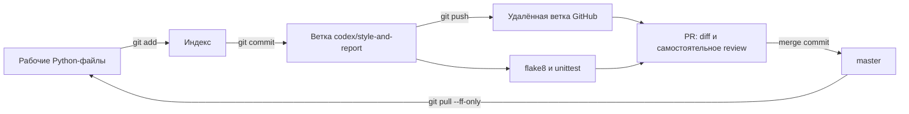

# Git и PEP 8 — стоимость работ мастерской

Макаров Артем Александрович · 3427А

## Проект и результат
Репозиторий: https://github.com/artem52qwe/MyPythonProject-chaper3006

Pull request №1, состояние MERGED: https://github.com/artem52qwe/MyPythonProject-chaper3006/pull/1

Самостоятельный проект рассчитывает стоимость партии работ мастерской. Реальных платежей нет. Название MyPythonProject-chaper3006 сохраняет основу MyPythonProject и добавляет суффикс для отдельного учебного варианта. Не использованы репозитории предыдущих вариантов.

## Выбор стандарта
| Документ | Назначение | Решение |
|---|---|---|
| PEP 8 | Соглашения оформления Python | Основной стандарт: 4 пробела, snake_case, пробелы после запятых, явные импорты, строки до 79 символов |
| Google Python Style Guide | Командные правила, документация, рекомендации по конструкции кода | Рассмотрен как более подробная политика; не объявляется полностью внедрённым |
| Правила проекта | Коммиты и проверка | Небольшой осмысленный commit, flake8 и unittest перед слиянием |

flake8 проверяет часть рекомендаций, а не весь PEP 8. Например, понятность имён и достаточность комментариев оцениваются при чтении. Финансовые значения хранятся целыми копейками; bool и отрицательные значения отклоняются.
## Выполненные операции и команды
1. `git clone URL git-project` — клонирован собственный новый репозиторий.
2. `git switch --orphan master` — выбрана основная ветка master в пустом репозитории.
3. `git config user.name ...` и `git config user.email ...` — локальная учебная подпись; реальные контактные данные не требуются.
4. `git add .` и `git commit -m "Initialize validated workshop cost modules"` — добавлены README, зависимости, модули и тесты.
5. `git push -u origin master` — опубликован первый снимок.
6. `git switch -c codex/style-and-report` — отдельная ветка новой функциональности.
7. `git add .` и `git commit -m "Introduce controlled style violations for inspection"` — зафиксирована специально нарушенная запятая и временный учебный файл.
8. `python -m flake8 ...` — выявлено E231; пробел исправлен, добавлен модуль форматирования рублей.
9. `git rm temporary-note.txt` — удалён только специально созданный временный файл; удаление сохраняется в истории.
10. `git add .` и `git commit -m "Fix formatting and add ruble report"` — зафиксированы исправление и функциональность.
11. `git push -u origin HEAD` — опубликована ветка; создан PR №1 в master.
12. После самостоятельного разбора diff PR объединён через GitHub merge commit; `git switch master` и `git pull --ff-only` синхронизировали локальную копию.
13. `git log --all --graph --oneline --decorate` — проверены история и обе ветки. Метки ci-before/ci-after фиксируют версии для CI.

Вместо примерных имён develop/feature используется codex/style-and-report. Она имеет ту же роль отдельной ветки разработки. PR не выдаётся за независимое одобрение: внешние участники не приглашались, выполнено учебное self-review, описанное в PR. Для настоящей командной работы потребуется отзыв другого участника.
## Проверка и исправления
| Проверка | До | После |
|---|---|---|
| flake8 pricing.py | `pricing.py:4:26: E231 missing whitespace after ','` | 0 замечаний в модулях приложения |
| unittest | Базовые проверки расчёта | 3/3 успешно: обычная цена, нулевое количество, некорректные значения |
| Функциональность | Итог в копейках | Читаемая сумма `110.00 RUB` |
| История | Намеренный дефект в отдельном commit | Исправление сохранено следующим commit, история не переписана |

Замечание self-review: арифметику денег оставить целочисленной, отображение вынести в reporting.py. Исправление: добавлен format_rubles, main.py вызывает его; проверены границы 0 и недопустимый ввод. Автоматическая проверка оформления не заменяет функциональные тесты.
## Поток работы с Git

## История коммитов
```text
* 4694d84 (HEAD -> master, origin/master, origin/HEAD) Package every application module and verify extracted release
* ee3bf4a Trust the exact read-only lab Git directory
* 761f596 Add isolated Jenkins and native memory laboratories
*   20d660f (tag: ci-after) Merge reviewed workshop formatting exercise
|\  
| * 052ffdc (origin/codex/style-and-report, codex/style-and-report) Fix formatting and add ruble report
| * 36e4f32 Introduce controlled style violations for inspection
|/  
* 30d6658 (tag: ci-before) Initialize validated workshop cost modules
```
## Снимки фактического состояния


### pricing.py
```python
"""Compute workshop material costs in integer kopecks."""


def batch_cost(unit_price, quantity):
    """Reject invalid prices and quantities before multiplying."""
    if type(unit_price) is not int or type(quantity) is not int:
        raise TypeError("Integer arguments required")
    if unit_price < 0 or quantity < 0:
        raise ValueError("Nonnegative arguments required")
    return unit_price * quantity
```

### reporting.py
```python
"""Render workshop totals without changing arithmetic."""


def format_rubles(kopecks):
    """Format integer money with exactly two decimal places."""
    rubles, remainder = divmod(kopecks, 100)
    return f"{rubles}.{remainder:02d} RUB"
```

### main.py
```python
"""Print a formatted workshop estimate."""
from pricing import batch_cost
from reporting import format_rubles


if __name__ == "__main__":
    print(format_rubles(batch_cost(2750, 4)))
```

### test_pricing.py
```python
"""Verify cost arithmetic and validation."""
import unittest
from pricing import batch_cost


class CostTests(unittest.TestCase):
    def test_cost(self):
        self.assertEqual(batch_cost(2750, 4), 11000)

    def test_zero(self):
        self.assertEqual(batch_cost(2750, 0), 0)

    def test_invalid(self):
        with self.assertRaises(ValueError):
            batch_cost(1, -1)
        with self.assertRaises(TypeError):
            batch_cost(True, 2)


if __name__ == "__main__":
    unittest.main()
```
## Источники
- PEP 8: https://peps.python.org/pep-0008/
- Google Python Style Guide: https://google.github.io/styleguide/pyguide.html
- Git: https://git-scm.com/docs
