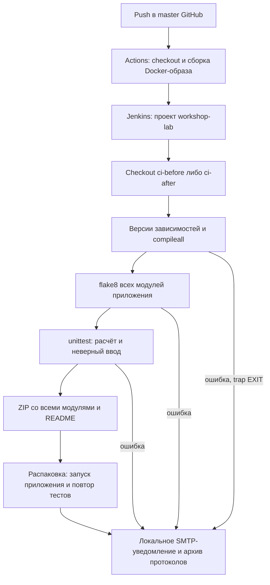

# Непрерывная интеграция мастерской в Jenkins

Макаров Артем Александрович · 3427А

## Стенд
Выбран Jenkins 2.580.2 (официальный образ, JDK 21) внутри Linux-контейнера, запускаемого GitHub Actions. Приложение рассчитывает стоимость работ мастерской. Репозиторий: https://github.com/artem52qwe/MyPythonProject-chaper3006. CI — интеграция с автоматическими проверками; CD может доставлять проверенный пакет. Здесь настроена CI со сборкой ZIP, производственное развёртывание не выполняется.

Создан проект Jenkins `workshop-lab` типа Freestyle. Исходники — read-only зеркало указанного GitHub-репозитория, которое GitHub Actions передаёт в /source. Первая сборка проверяет тег ci-before (30d6658), вторая — ci-after (20d660f), где появился модуль вывода суммы в рублях. Зависимости устанавливаются в Dockerfile: Python 3, flake8 и Git. При каждой сборке проверяются их версии; у приложения нет внешних runtime-зависимостей.

Jenkins требует вход, анонимное чтение выключено; контейнер не публикует порт и работает с `--network none`. Учётная запись создаётся с непубликуемым случайным паролем. Уведомления email действительно формируются и принимаются локальным SMTP на loopback внутри процесса; файлы notice-1.eml и notice-2.eml содержат результат. Внешняя доставка запрещена выбранным учебным режимом. Регистрация на общем «сайте Jenkins» не требуется для самостоятельно установленного сервера.

## Схема настройки


## Результаты фактического запуска
Успешный запуск: https://github.com/artem52qwe/MyPythonProject-chaper3006/actions/runs/40945204215

| Проверка | До изменения приложения | После изменения приложения |
|---|---|---|
| Jenkins | SUCCESS, сборка №1 | SUCCESS, сборка №2 |
| Длительность job | 437 мс | 938 мс |
| unittest исходников | 3/3, 0 ошибок | 3/3, 0 ошибок |
| flake8 и compileall | Успех | Успех |
| Распакованный ZIP | Запуск и 3/3 теста | Запуск и 3/3 теста |
| Уведомление | notice-1.eml сохранено | notice-2.eml сохранено |

Длительность job включает checkout, проверки, упаковку и уведомление, но не подготовку GitHub runner и сборку Docker-образа. unittest округляет время малых тестов до 0.000 с: это не означает нулевую реальную длительность. Два запуска не дают статистической оценки ускорения. После изменения логика отображения усложнилась, поэтому сравнение времени не используется как доказательство регрессии или оптимизации.

Первый эксперимент выявил одну инфраструктурную ошибку Git dubious ownership. Разрешено доверие только к собственному read-only пути /source/.git; глобальное доверие ко всем каталогам не включалось. При проверке упаковки обнаружен пропуск reporting.py: исправлена упаковка всех Python-модулей и добавлен запуск распакованного пакета. Финальный запуск после обоих исправлений успешен.

## Эффективность и ограничения
Проверки быстро обнаруживают синтаксические ошибки, нарушения стиля и регрессию расчёта. Отдельный тест ZIP предотвращает выпуск неполного артефакта. Для маленького проекта основные затраты — подготовка контейнера; в постоянном Jenkins агент можно переиспользовать. Три теста не обеспечивают полное покрытие требований. Для реальной команды нужны независимое review, постоянное хранение истории и согласованный SMTP; эти действия здесь не имитируются.
## Снимки настроек и результатов
Снимки показывают фактическую конфигурацию Jenkins как код и сохранённый вывод выполненной job. Это читаемое представление применённых файлов, а не скриншоты веб-форм Jenkins: временный изолированный контейнер не публикует веб-интерфейс.


### Dockerfile
```dockerfile
FROM jenkins/jenkins:2.580.2-jdk21
USER root
RUN apt-get update && apt-get install -y python3 python3-flake8 git && apt-get clean
USER jenkins
COPY ci/init.groovy /usr/share/jenkins/ref/init.groovy.d/lab.groovy
ENV JAVA_OPTS="-Djenkins.install.runSetupWizard=false"
```

### init.groovy
```groovy
import jenkins.model.Jenkins
import hudson.model.FreeStyleProject
import hudson.tasks.Shell
import hudson.security.HudsonPrivateSecurityRealm
import hudson.security.FullControlOnceLoggedInAuthorizationStrategy
def j = Jenkins.get()
def realm = new HudsonPrivateSecurityRealm(false)
realm.createAccount("lab-admin", UUID.randomUUID().toString())
j.setSecurityRealm(realm)
def auth = new FullControlOnceLoggedInAuthorizationStrategy()
auth.setAllowAnonymousRead(false)
j.setAuthorizationStrategy(auth)
j.setNumExecutors(1)
def project = j.createProject(FreeStyleProject, "workshop-lab")
project.setDescription("GitHub repository: https://github.com/artem52qwe/MyPythonProject-chaper3006.git; checkout from its local read-only mirror /source")
project.getBuildersList().add(new Shell(new File('/source/ci/build.sh').text))
project.save()
j.save()
Thread.start {
    try {
        sleep(8000)
        def results = []
        for (int i = 1; i <= 2; i++) {
            def build = project.scheduleBuild2(0).get()
            new File("/out/build-${i}.log").text = build.getLog(10000).join("\n")
            results.add([number: build.number, result: build.result.toString(), duration_ms: build.duration])
        }
        new File('/out/results.json').text = groovy.json.JsonOutput.toJson(results)
        new File('/out/done').text = 'complete'
    } catch (Throwable error) {
        new File('/out/failure.txt').text = error.toString()
    }
}
```

### build.sh
```bash
#!/bin/bash
set -eu
trap 'result=$?; python3 /source/ci/notify.py "$result"' EXIT
echo "STAGE checkout: read-only mirror of GitHub repository"
git config --global --add safe.directory /source
git config --global --add safe.directory /source/.git
git clone /source "workshop-$BUILD_NUMBER"
cd "workshop-$BUILD_NUMBER"
if [ "$BUILD_NUMBER" = 1 ]; then git checkout ci-before; else git checkout ci-after; fi
git log -1 --format='%H %s'
echo "STAGE dependencies: Python and flake8 installed in immutable image"
python3 --version
python3 -m flake8 --version
echo "STAGE syntax"
python3 -m compileall -q .
echo "STAGE quality"
python3 -m flake8 ./*.py
echo "STAGE tests"
python3 -m unittest -v
echo "STAGE package"
python3 -m zipfile -c "/out/workshop-$BUILD_NUMBER.zip" ./*.py README.md requirements.txt
python3 -m zipfile -e "/out/workshop-$BUILD_NUMBER.zip" package-check
(cd package-check && python3 main.py && python3 -m unittest -v)
python3 main.py
```

### notify.py
```python
"""Send a build notification to an ephemeral local-only SMTP sink."""
import os
from pathlib import Path
import smtplib
import socketserver
import sys
import threading


class Handler(socketserver.StreamRequestHandler):
    def handle(self):
        self.wfile.write(b'220 local-lab\r\n')
        while True:
            line = self.rfile.readline()
            if not line:
                return
            command = line.upper()
            if command.startswith(b'DATA'):
                self.wfile.write(b'354 End with dot\r\n')
                message = []
                while True:
                    line = self.rfile.readline()
                    if line in (b'.\r\n', b''):
                        break
                    message.append(line)
                target = Path('/out') / (
                    'notice-' + os.environ['BUILD_NUMBER'] + '.eml')
                target.write_bytes(b''.join(message))
                self.wfile.write(b'250 accepted\r\n')
            elif command.startswith(b'QUIT'):
                self.wfile.write(b'221 bye\r\n')
                return
            else:
                self.wfile.write(b'250 OK\r\n')


with socketserver.TCPServer(('127.0.0.1', 0), Handler) as server:
    worker = threading.Thread(target=server.serve_forever, daemon=True)
    worker.start()
    port = server.server_address[1]
    message = ('Subject: Build ' + os.environ['BUILD_NUMBER']
               + '\r\n\r\nExit status: ' + sys.argv[1])
    with smtplib.SMTP('127.0.0.1', port, timeout=5) as smtp:
        smtp.sendmail('jenkins@localhost', ['student@localhost'], message)
    server.shutdown()
print('LOCAL SMTP: notification captured, no external recipient')
```

### jenkins.yml
```yaml
name: Jenkins Docker laboratory
on:
  push:
    branches: [master]
permissions:
  contents: read
jobs:
  jenkins:
    runs-on: ubuntu-latest
    timeout-minutes: 15
    steps:
      - uses: actions/checkout@v4
        with:
          fetch-depth: 0
          persist-credentials: false
      - name: Build isolated Jenkins image
        run: docker build -f ci/Dockerfile -t jenkins-lab .
      - name: Execute two builds
        run: |
          mkdir -p output
          chmod 777 output
          docker run -d --name jenkins-lab --network none -v "$PWD:/source:ro" -v "$PWD/output:/out" jenkins-lab
          for i in $(seq 1 120); do
            if [ -f output/done ] || [ -f output/failure.txt ]; then break; fi
            sleep 3
          done
          docker logs jenkins-lab > output/jenkins.log 2>&1
          python3 -c "import json; r=json.load(open('output/results.json')); assert len(r)==2 and all(x['result']=='SUCCESS' for x in r), r"
      - name: Publish evidence
        if: always()
        run: |
          for file in output/results.json output/build-1.log output/build-2.log output/notice-1.eml output/notice-2.eml output/failure.txt; do
            if [ -f "$file" ]; then
              echo "### $file" >> "$GITHUB_STEP_SUMMARY"
              echo '```text' >> "$GITHUB_STEP_SUMMARY"
              cat "$file" >> "$GITHUB_STEP_SUMMARY"
              echo '' >> "$GITHUB_STEP_SUMMARY"
              echo '```' >> "$GITHUB_STEP_SUMMARY"
            fi
          done
      - uses: actions/upload-artifact@v4
        if: always()
        with:
          name: jenkins-evidence
          path: output/
```

### build-2.log
```text
Legacy code started this job.  No cause information is available
Running as SYSTEM
Building in workspace /var/jenkins_home/workspace/workshop-lab
[workshop-lab] $ /bin/bash /tmp/jenkins8269195971421993323.sh
STAGE checkout: read-only mirror of GitHub repository
Cloning into 'workshop-2'...
done.
Note: switching to 'ci-after'.

You are in 'detached HEAD' state. You can look around, make experimental
changes and commit them, and you can discard any commits you make in this
state without impacting any branches by switching back to a branch.

If you want to create a new branch to retain commits you create, you may
do so (now or later) by using -c with the switch command. Example:

  git switch -c <new-branch-name>

Or undo this operation with:

  git switch -

Turn off this advice by setting config variable advice.detachedHead to false

HEAD is now at 20d660f Merge reviewed workshop formatting exercise
20d660f25b608e28c19a357e20085de178ec59b5 Merge reviewed workshop formatting exercise
STAGE dependencies: Python and flake8 installed in immutable image
Python 3.13.5
7.1.1 (mccabe: 0.7.0, pycodestyle: 2.12.1, pyflakes: 3.2.0) CPython 3.13.5 on
Linux
STAGE syntax
STAGE quality
STAGE tests
test_cost (test_pricing.CostTests.test_cost) ... ok
test_invalid (test_pricing.CostTests.test_invalid) ... ok
test_zero (test_pricing.CostTests.test_zero) ... ok

----------------------------------------------------------------------
Ran 3 tests in 0.000s

OK
STAGE package
110.00 RUB
test_cost (test_pricing.CostTests.test_cost) ... ok
test_invalid (test_pricing.CostTests.test_invalid) ... ok
test_zero (test_pricing.CostTests.test_zero) ... ok

----------------------------------------------------------------------
Ran 3 tests in 0.000s

OK
110.00 RUB
LOCAL SMTP: notification captured, no external recipient
Finished: SUCCESS
```
## Официальные источники
- Jenkins Docker: https://www.jenkins.io/doc/book/installing/docker/
- Jenkins: https://www.jenkins.io/doc/book/
- Python unittest: https://docs.python.org/3/library/unittest.html
