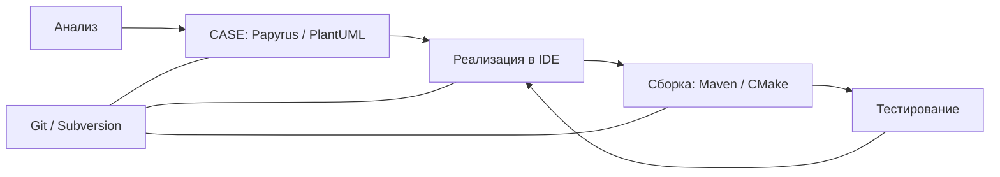

# Инструменты и этапы разработки

Макаров Артем Александрович · 3427А

## Таблица
Примеры сценариев ниже — применение к реальным типам проектов, а не утверждение об использовании конкретной компанией. Проверяемые публичные примеры: Git разработан для Linux; тестирование CPython описано в руководстве разработчика.
| Тип | Название | Функции | Этап | Пример использования |
|---|---|---|---|---|
| IDE | NetBeans | Редактор и отладка | Реализация | Java-клиент учёта оборудования |
| IDE | Eclipse IDE | Навигация, плагины, debugger | Реализация | Java-сервис каталога |
| СКВ | Git | Коммиты и ветки | Все изменения | История Linux и учебного Python-проекта |
| СКВ | Subversion | Централизованные версии | Совместная работа | Единый архив исходников организации |
| CASE | Papyrus | UML-модели | Анализ и проектирование | Модель оборудования и выдач |
| CASE / диаграммы | PlantUML | Текстовые UML-диаграммы | Проектирование и документация | Версионируемая схема последовательности |
| Сборка | Maven | Зависимости и lifecycle | Сборка и тестирование | Java-пакет с тестами |
| Сборка | CMake | Генерация систем сборки | Сборка C/C++ | Нативная библиотека обработки измерений |

Вывод: СКВ охватывает несколько этапов, а сборка не равна компиляции одного файла. PlantUML является средством диаграмм и не заявляется полноценным репозиторием моделей.
## Официальные источники
- Apache NetBeans: https://netbeans.apache.org/front/main/index.html
- Eclipse IDE: https://www.eclipse.org/ide/
- Git: https://git-scm.com/about
- Subversion: https://subversion.apache.org/
- Papyrus: https://eclipse.dev/papyrus/
- PlantUML: https://plantuml.com/
- Maven: https://maven.apache.org/what-is-maven.html
- CMake: https://cmake.org/

## Проверяемые примеры из существующих проектов
- Papyrus используется в бортовом ПО TARANIS и в Sim4Sys; примеры опубликованы самим проектом: https://eclipse.dev/papyrus/index.html
- LLVM документирует конфигурацию и сборку с CMake: https://llvm.org/docs/CMake.html
- Apache Commons Lang использует Maven: https://commons.apache.org/proper/commons-lang/building.html
- GitLab поддерживает интеграцию PlantUML для диаграмм в проектной документации: https://docs.gitlab.com/administration/integration/plantuml/
- NetBeans публикует воспроизводимый проект модульного настольного приложения: https://netbeans.apache.org/tutorial/main/tutorials/nbm-quick-start/ . Это учебный пример, а не заявление о промышленном внедрении.
