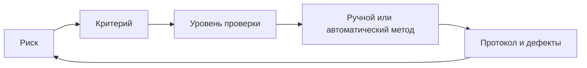

# Выбор видов тестирования по рискам

Макаров Артем Александрович · 3427А

## Введение
Для веб-сервиса проката наиболее дорогие ошибки — двойная выдача прибора, доступ к чужой записи и потеря подтверждённой операции. Поэтому план начинается с рисков, а не со списка инструментов.
| Вид / метод | Что проверяет | Цена и время | Польза | Ограничение |
|---|---|---|---|---|
| Функциональное, автоматические сценарии | Выдача, возврат, отмена | Средние затраты подготовки, быстрый повтор | Сверка с правилами | Ошибочный критерий даёт ошибочную уверенность |
| Интеграционное | API, БД, транзакции | Нужен стенд | Находит двойную запись и рассогласование | Зависит от конфигурации |
| Нагрузочное | p95, ошибки, ресурсы | Дорогой контролируемый эксперимент | Выявляет насыщение | Не равно доказательству корректности |
| Регрессионное | Сохранение прежнего поведения | Состав растёт, нужна приоритизация | Защищает от повторных дефектов | Устаревшие тесты требуют поддержки |
| Исследовательское ручное | Неожиданные сценарии, удобство | Время специалиста | Находит непредусмотренные проблемы | Труднее воспроизвести без записей |
| Модульное | Границы функции | Малые затраты исполнения | Быстрая локализация | Не видит реальную сеть и БД |

## Применимость
- Веб: API и права плюс несколько браузерных сценариев.
- Мобильное: разрывы связи, фон/возврат, разные размеры экрана и разрешения.
- Корпоративное: миграции, интеграции, аудит и восстановление.
- Критичные системы: независимая проверка требований, негативные и аварийные сценарии, анализ опасностей; одной автоматизации недостаточно.

## Заключение
Эффективность определяется обнаружением значимых дефектов и скоростью обратной связи. Не измеренные проценты «эффективности» не назначаются. Для проката первыми автоматизируются расчёт, права и конкурентная выдача; нагрузка и удобство проверяются отдельно.
## Источники
- Selenium: https://www.selenium.dev/documentation/
- pytest: https://docs.pytest.org/en/stable/
- JUnit: https://junit.org/
