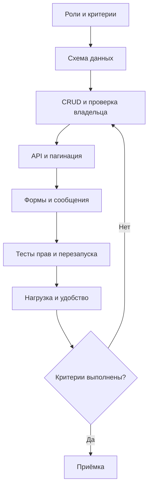

# Управление задачами: уточнение исходных требований

Макаров Артем Александрович · 3427А

## Классификация
| Исходное требование | Компонент | Проверяемое уточнение |
|---|---|---|
| Создание, редактирование, удаление задач | F | CRUD по ID; удаление архивирует запись и историю |
| Простой интерфейс | U | 4 из 5 новичков создают задачу за 2 минуты |
| Быстро без задержек | P | p95 списка ≤ 1 с на 10 000 задач при 40 пользователях |
| Устойчивость и сохранение после перезагрузки | R | Подтверждённая задача сохраняется после рестарта сервиса |
| Защита от чужого доступа | F (безопасность) | Сервер проверяет владельца для каждого ID |
| Дополнение автора: сопровождение | S | Сервис задач отделён от UI, тесты CRUD и прав |
| Дополнение автора: интерфейс | + | JSON API v1, TLS, UTC |

## План реализации
1. Согласовать роли и примеры отказов. Таблицы User, Task и Event с внешними ключами.
2. Реализовать сервис CRUD и проверки владельца. DELETE выполняет архивирование.
3. Добавить GET /tasks с пагинацией, POST /tasks, PATCH /tasks/{id}, DELETE /tasks/{id}.
4. Построить формы списка и редактирования с явными сообщениями об ошибке.
5. Проверить права, рестарт, нагрузку и сценарий новичка; устранить дефекты перед выпуском.

Численные значения — предложенные уточнения расплывчатых исходных фраз, а не результаты измерений.
## Источники
- Инженерия требований, ISO/IEC/IEEE 29148:2018: https://www.iso.org/standard/72089.html
- Процессы жизненного цикла, ISO/IEC/IEEE 12207:2026: https://www.iso.org/standard/90219.html
- Модель качества продукта, ISO/IEC 25010:2023: https://www.iso.org/standard/78176.html
