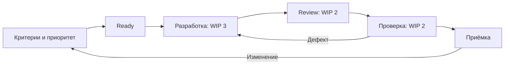

# Веб-каталог мастер-классов — организация команды

Макаров Артем Александрович · 3427А

## Цель и границы
Веб-каталог мастер-классов. 4 недели: каталог, запись, подтверждение. Цель пилота — провести один полный пользовательский сценарий и сохранить его историю. Оплата, приглашения внешних участников и реальные уведомления исключены из учебного стенда.
## Роли
Учебное допущение: 6 участников — менеджер, аналитик, 2 разработчика, тестировщик и дизайнер. Численность не задана условием.
| Роль | Зона ответственности |
|---|---|
| M | Менеджер и согласование приоритетов |
| A | Аналитик: правила и примеры |
| D1 | Backend, API и данные |
| D2 | Frontend и интеграция |
| Q | Тестирование и регрессия |
| UX | Дизайнер: формы и доступность |

## Метод организации
Выбран Kanban с еженедельной демонстрацией: задачи имеют разную длительность, а интеграционные зависимости меняются. Ready содержит согласованные критерии и оценку; в разработке не более 3 карточек, в review не более 2, в тестировании не более 2. При переполнении следующей стадии команда помогает завершать работу. Заблокированная карточка остаётся в WIP. Срочное изменение допускается только после решения менеджера о вытеснении другой работы.

## График и контрольные точки
Даты являются планом будущего учебного проекта, не историей выполненных работ.
| Начало | Конец | Этап / владелец | Контрольная точка |
|---|---|---|---|
| 02.11.2026 | 04.11.2026 | Требования / аналитик | Примеры нормального и ошибочного сценария согласованы |
| 05.11.2026 | 06.11.2026 | Контракт и прототип / D1, дизайнер либо D4 | Схема данных и форма проверены аналитиком |
| 09.11.2026 | 13.11.2026 | Первый вертикальный сценарий / разработчики | Создание объекта через UI и сохранение в БД |
| 16.11.2026 | 20.11.2026 | Остальные переходы и интеграция / разработчики, QA | Проверены права, повторы запросов и конфликт версий |
| 23.11.2026 | 25.11.2026 | Регрессия и восстановление / QA и ответственный за данные | Протокол тестов и успешное восстановление копии |
| 26.11.2026 | 27.11.2026 | Учебный выпуск / менеджер и команда | Приёмка, инструкция запуска, план отката |
| После 27.11.2026 | Еженедельно | Поддержка / дежурный разработчик | Разбор ошибок и обновление документации |

## Коммуникации и инструменты
Git хранит изменения; задача в трекере содержит критерии, владельца и ссылки на PR. Доска Kanban показывает текущее состояние, а не только процент завершения. Командный чат используется для коротких уточнений; решение из чата переносится в задачу. Внешние сервисы этим планом не создаются.
Ежедневно в 10:15 — 10 минут о препятствиях. Во вторник и четверг — уточнение ближайших карточек, 25 минут. В пятницу — 40 минут демонстрации и 20 минут разбора процесса. Срочное препятствие получает владельца в рабочее время; если оно не снято за день, руководитель пересматривает зависимость или объём.

## Контроль качества и отчётность
До реализации QA и аналитик формулируют примеры. Python оформляется по PEP 8: 4 пробела, snake_case, явные импорты, короткие функции с контрактом; flake8 проверяет стиль, тесты — смысл. Для C# используются осмысленные имена и единый формат. Изменение проходит короткую ветку, PR, независимое review и CI. Это план командных правил, не заявление о настроенной защите ветки.
Готовность означает выполненные критерии, тесты, review, документацию и проверку отката. Еженедельный отчёт содержит завершённые сценарии, возраст незавершённых карточек, препятствия, дефекты и прогноз. Процент готовности не вычисляется по числу написанных строк. Метрики cycle time и возвратов сравниваются для одинаковых типов задач.

## Риски, конфликты и мотивация
| Риск | Сигнал | Действие | Ответственный |
|---|---|---|---|
| Очередь QA | Карточка ждёт более 1 дня | Разработчики помогают воспроизведению и тестам | Технический координатор |
| Неясный критерий | Разные ожидаемые результаты | Уточнить пример до кодирования | Аналитик |
| Ошибка миграции | Не проходит восстановление | Остановить выпуск, исправить и повторить | Ответственный за данные |
| Концентрация знаний | Единственный reviewer | Парная работа, ротация и краткая инструкция | Руководитель |
Спор разбирается по фактам: описать варианты, критерии и последствия; при необходимости провести ограниченный эксперимент. Техническое решение фиксирует координатор, изменение приоритета — менеджер. Конфликт Git разрешается после согласования смысла, затем повторяются тесты. Force-push общей ветки не применяется.
Мотивация строится на видимом завершённом результате, признании помощи коллегам и времени на обучение. Количество коммитов не используется для рейтинга людей. Раз в две недели участник выбирает небольшую область развития и получает обратную связь по конкретному результату.

## Схема

## Источники
- The Kanban Guide: https://kanbanguides.org/the-kanban-guide
- PEP 8: https://peps.python.org/pep-0008/
